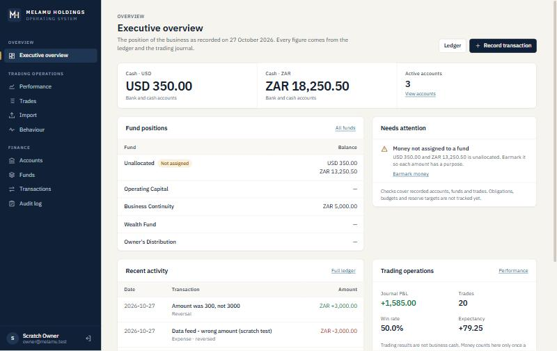
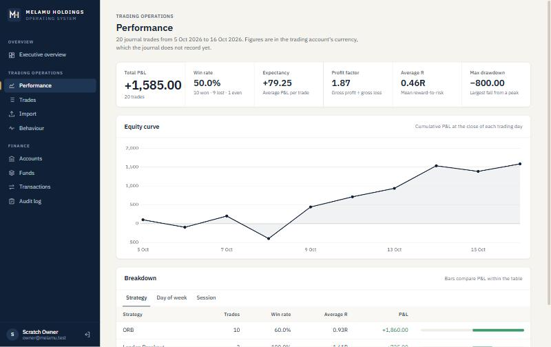
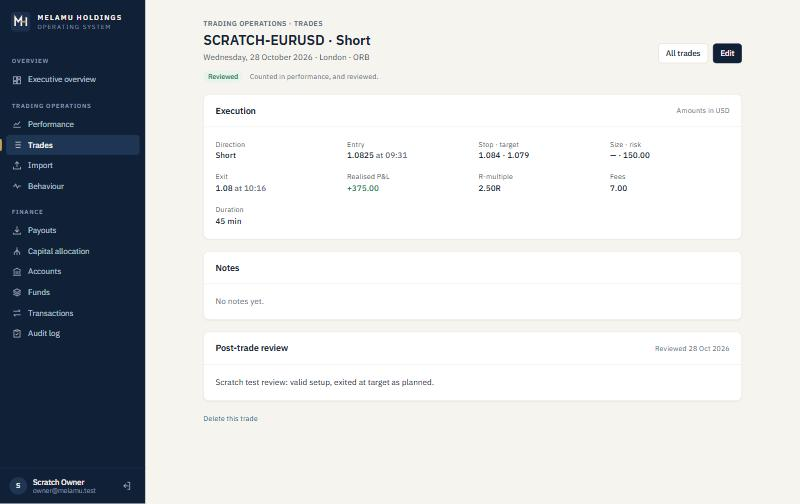
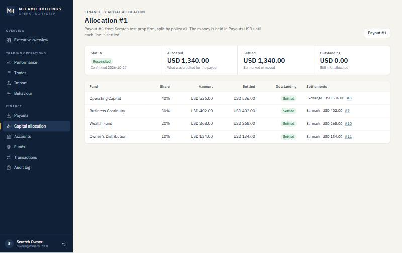

# Melamu Holdings OS

A unified operating system for managing trading operations, financial performance, capital allocation, wealth creation and business continuity.

> **Status: in transformation.** This repository started as the *Trader Performance Analytics Dashboard* and is being evolved into Melamu Holdings OS in phases (see [`PLAN.md`](PLAN.md)).
>
> **What works today:**
> - the trading module;
> - **Financial Management**: accounts, funds, an auditable ledger and balances.
>
> **Payouts and capital allocation** work end to end: request → approve → receive → allocate 40/30/20/10 → settle. Business continuity, wealth management and planning are **planned, not built**. The navigation lists only what works; the roadmap is in [`PLAN.md`](PLAN.md).



*Executive overview, the landing page, shown here with scratch test data.*

## What works today: executive overview

The landing page shows the business as recorded:
- cash by currency (never added across currencies);
- fund positions;
- what needs attention, derived from records: unallocated money, accounts below zero, ownership not stated, critical trading-behaviour alerts;
- recent ledger activity;
- a trading summary, labelled as not business cash until a payout is recorded.

## What works today: trading operations



### Trading journal



- **New trade:** record a trade by hand, as a **draft** (just date and instrument), **open** (entry recorded) or **closed** (exit and P&L recorded). Nothing missing is filled in with zeros.
- **Journal entry page:** execution, notes and a **post-trade review**; marking a closed trade reviewed keeps your own words. R-multiple, duration and day are calculated from what you recorded.
- **Only closed and reviewed trades count** in performance and behaviour analytics; drafts and open positions never move the numbers.
- A retried save cannot create the same trade twice (`Idempotency-Key`).
- **Strategies and checklists:** each strategy has your own rules, mandatory or optional. A trade's checklist records whether each rule was met, keeps every change, and is never rewritten when a rule is reworded later. **Rule adherence** is shown with its denominator: of the closed trades with a complete checklist, how many followed every mandatory rule. Results of trades that did and did not follow the rules are compared side by side, labelled when the sample is small, and never presented as cause and effect.
- **Journal templates:** the questions answered for each trade (context, a pre-trade checklist, psychology, post-trade review and lessons), from a standard template you can edit, duplicate, archive or replace as the default. The editor shows a live preview. Changing the questions creates a new version, and trades already journaled keep the version they were written with. Required questions must be answered before a trade can be marked reviewed.
- The design for checklists, strategy rules and AI-assisted review is in [`docs/TRADING_JOURNAL_DESIGN.md`](docs/TRADING_JOURNAL_DESIGN.md).
- Import trades from CSV, with row-level validation. Valid rows are kept and failed rows are reported with their row number.
- Upload history per user.
- Strategies are created automatically from the CSV `Strategy` column.
- View, search and delete trades. Search covers instrument, strategy, session and day; filters cover direction and result.

### Performance analytics
- **Win rate**: winning trades ÷ total trades.
- **Expectancy**: (win rate × average win) − (loss rate × average loss). Loss rate counts losing trades only, so this equals the mean P&L per trade; breakevens count as zero.
- **Profit factor**: gross profit ÷ gross loss. *Known issue:* with no losing trades it currently shows gross profit instead of "undefined"; the fix is scheduled for Phase 8.
- **Average RR**: mean reward-to-risk ratio.
- **Equity curve**: cumulative P&L by day.
- **Max drawdown**: the largest peak-to-trough fall in cumulative P&L.
- **Breakdowns**: by strategy, day of week and trading session.

### Behavioural analytics
- **Revenge trading**: a trade entered within 20 minutes of a losing trade on the same day.
- **Overtrading**: more than 5 trades in a day (Critical above 10).
- **Loss streaks**: 3 or more consecutive losses (Critical at 5).
- **Rule deviations**: the count and P&L of trades marked as manual overrides.

## What works today: payouts and capital allocation



- **Payouts** move Requested → Approved → Received (or Rejected). A request or approval is never cash; receiving records what actually reached the account, with any fee deducted on the way kept visible, and posts it to Unallocated.
- **Allocation policies** are versioned and never edited. Version 1 is 40 / 30 / 20 / 10 (Operating Capital, Business Continuity, Wealth Fund, Owner's Distribution), seeded as configuration.
- **Allocation:** preview the split (cent-exact, largest remainder), confirm it once per payout, then settle each line by earmarking in place, transferring, or exchanging into another currency. Status (Confirmed → Partially settled → Reconciled) follows the settlements, and reversing one reopens its line.
- **Currency conversions** keep the amounts, the effective rate calculated from them, an optional quoted rate from the provider, and any fee.

## What works today: financial management

- **Accounts:** real places money is held (Bank, Cash, Brokerage), each in one fixed currency with stated ownership. They close only at a zero balance. No credentials are stored.
- **Funds:** what money is earmarked for. The defaults are Unallocated, Operating Capital, Business Continuity, Wealth Fund and Owner's Distribution. One account can hold several funds.
- **Ledger:** record income, expenses, transfers, earmarks (between funds inside one account), currency exchanges (USD → ZAR at the rate you actually got) and opening balances.
  - Entries are never edited.
  - Mistakes are reversed, once, with a reason.
  - Retries are safe, because each submission carries an idempotency key.
- **Balances:** always summed from entries.
  - Per account, with a per-fund breakdown.
  - Per fund, in each currency; currencies are never added together.
  - Cash totals for Bank and Cash accounts.
  - Optionally as of a date.
- **Audit log:** every finance change, with who made it and when.

The rules and formulas are in [`docs/FINANCIAL_DOMAIN.md`](docs/FINANCIAL_DOMAIN.md). This is an operational record of money, not accounting software.

## Access
- **Single operator.** There is no public sign-up; the owner account is created from the command line.
- JWT authentication (8-hour tokens) with BCrypt password hashing and login rate limiting.
- **Trading data** is scoped to the signed-in user. **Finance data** belongs to the business and requires the Owner role.

## Tech stack

| Layer | Technology |
|---|---|
| Frontend | Angular 21: standalone components, signals, zoneless change detection; own design system (IBM Plex, no UI framework) |
| Backend | ASP.NET Core Web API (.NET 10), RFC 7807 ProblemDetails |
| Database | SQL Server with Entity Framework Core 10 migrations |
| Auth | JWT bearer tokens, BCrypt |
| Charts | Chart.js via ng2-charts |
| Tests | xUnit (unit and API integration against SQL Server), Vitest (Angular) |
| CI | GitHub Actions |

## Architecture

```
MelamuHoldings.Domain          Identity/, Trading/, Finance/ (Money, Currency), Common/ (no dependencies)
MelamuHoldings.Application     Identity/, Trading/ services, DTOs and repository interfaces
MelamuHoldings.Infrastructure  Persistence/ (DbContext, configurations, migrations, repositories)
MelamuHoldings.API             Controllers/<Module>/, auth, error handling, `create-owner` command
MelamuHoldings.Angular         core/ (auth, layout), shared/ (incl. ui/ design-system components), features/ (overview, trading, finance)
tests/                         unit and API integration tests
```

Dependencies point inwards:
- API → Application → Domain.
- Infrastructure implements the Application interfaces and is wired up at startup through dependency injection.
- Modules depend in one direction only: trading records reference their user, never the reverse.

Details are in [`docs/ARCHITECTURE.md`](docs/ARCHITECTURE.md).

## Running locally

You need:
- the .NET 10 SDK;
- Node 22;
- SQL Server Express (`.\SQLEXPRESS`) or another SQL Server, with the connection set in `MelamuHoldings.API/appsettings.Development.json`;
- `dotnet-ef`.

1. Set a JWT signing key (once per machine):

   ```bash
   dotnet user-secrets set "Jwt:Key" "<at least 32 random characters>" --project MelamuHoldings.API
   ```

2. Create the database:

   ```bash
   dotnet ef database update --project MelamuHoldings.Infrastructure --startup-project MelamuHoldings.API
   ```

3. Create your login:

   ```bash
   dotnet run --project MelamuHoldings.API -- create-owner
   ```

4. Start the API on http://localhost:5051:

   ```bash
   dotnet run --project MelamuHoldings.API --launch-profile http
   ```

5. Start the frontend on http://localhost:4200:

   ```bash
   npm --prefix MelamuHoldings.Angular start
   ```

   Signing in lands on the Executive overview (`/overview`). The trading pages are under `/trading/…` and the finance pages under `/finance/…`.

### CSV format

The journal CSV needs a header row with these columns:

```
TradeDate, EntryTime, Instrument, Direction, EntryPrice, ExitPrice,
RiskAmount, PnL, RR, Strategy, Session, DayOfWeek, TradeDuration,
Notes, IsManualOverride, DeviationNotes
```

`Direction` is `Long` or `Short`, and entry and exit prices must be greater than zero.

## API endpoints

All endpoints except login require a bearer token. Errors are returned as ProblemDetails.

| Method | Endpoint | Description |
|---|---|---|
| POST | `/api/auth/login` | Sign in; returns a JWT |
| GET | `/api/trades?status=` | List your trades, optionally by status (`Draft`, `Open`, `Closed`, `Reviewed`) |
| GET | `/api/trades/{id}` | Get one trade |
| POST | `/api/trades` | Create a journal entry (`status` Draft, Open or Closed; Closed if omitted; optional `journal` and `checklist` answers); accepts `Idempotency-Key` |
| PUT | `/api/trades/{id}` | Update a journal entry (omit `status` to keep it) |
| POST | `/api/trades/{id}/review` | Mark a closed trade reviewed, with the review notes (refused while required journal questions are unanswered) |
| GET | `/api/journal-templates?includeArchived=` | List your journal templates (the standard one is created on first use) |
| GET | `/api/journal-templates/{id}` | Get a template with its current questions and versions |
| GET | `/api/journal-templates/{id}/versions/{version}` | Get the questions of one version |
| POST | `/api/journal-templates` | Create a template |
| PUT | `/api/journal-templates/{id}` | Update a template; changed questions create a new version |
| POST | `/api/journal-templates/{id}/duplicate` · `/archive` · `/restore` · `/make-default` | Template actions |
| GET | `/api/strategies?includeArchived=` | List your strategies with their rules and trade counts |
| GET | `/api/strategies/{id}` | Get a strategy with its active and retired rules |
| POST | `/api/strategies` | Create a strategy with its rules |
| PUT | `/api/strategies/{id}` | Update a strategy; rules left out are retired |
| POST | `/api/strategies/{id}/archive` · `/restore` · `/rules/{ruleId}/restore` | Strategy actions |
| DELETE | `/api/trades/{id}` | Delete a trade |
| POST | `/api/upload` | Import a CSV journal (max 10 MB) |
| GET | `/api/upload/logs` | Upload history |
| GET | `/api/analytics/summary` | KPI summary |
| GET | `/api/analytics/equity-curve` | Daily equity curve |
| GET | `/api/analytics/by-strategy` | Strategy breakdown |
| GET | `/api/analytics/by-day` | Performance by day of week |
| GET | `/api/analytics/by-session` | Performance by session |
| GET | `/api/analytics/behaviour` | Behavioural alerts and metrics |
| GET | `/api/analytics/adherence?strategyId=` | Rule adherence over closed trades, with results compared and sample sizes |

**Finance endpoints** require the Owner role. Money-moving POSTs accept an `Idempotency-Key` header: a retry with the same key returns the original (`Idempotent-Replayed: true`) instead of posting twice.

| Method | Endpoint | Description |
|---|---|---|
| GET / POST | `/api/funds` | List funds with per-currency balances / create a fund |
| PUT | `/api/funds/{id}` | Rename or describe a fund (not the system fund's name) |
| GET / POST | `/api/financial-accounts` | List accounts with balances / create an account |
| GET / PUT | `/api/financial-accounts/{id}` | One account / update name, ownership, institution, notes |
| POST | `/api/financial-accounts/{id}/close` | Close an account (only at a zero balance) |
| POST | `/api/transactions/{opening-balance\|income\|expense\|transfer\|reallocation\|exchange}` | Record a money movement |
| POST | `/api/transactions/{id}/reverse` | Reverse a transaction (once, with a reason) |
| GET | `/api/transactions` | The ledger; filter by `from`, `to`, `type`, `accountId`, `fundId`; paged |
| GET | `/api/transactions/{id}` | One transaction with its entries |
| GET | `/api/balances?asOf=` | Account, fund and cash balances, optionally as of a date |
| GET | `/api/audit-events` | Audit log, newest first, paged |
| GET | `/api/currencies` | Supported currencies |
| GET / POST | `/api/payouts` | List payouts (optional `status`) / record a payout request |
| GET | `/api/payouts/{id}` | One payout with its receipt and allocation status |
| POST | `/api/payouts/{id}/{approve\|reject\|receive\|undo-receipt}` | Move a payout along; only `receive` posts to the ledger |
| GET / POST | `/api/allocation-policies` | Policy versions / create a new version (optionally active) |
| POST | `/api/allocation-policies/{id}/activate` | Make a version the one used for new allocations |
| POST | `/api/allocations/preview` | Split a received payout by a policy; stores nothing |
| GET / POST | `/api/allocations` | Allocations / confirm one |
| GET | `/api/allocations/{id}` | One allocation with lines, settlements and derived status |
| POST | `/api/allocations/{id}/lines/{lineId}/settle` | Settle a line by earmark, transfer or exchange |
| POST | `/api/allocations/{id}/cancel` | Cancel, only while nothing is settled |

## Tests

```bash
dotnet test MelamuHoldings.slnx
```

```bash
npm --prefix MelamuHoldings.Angular test -- --watch=false
```

The integration tests need SQL Server. Details and the latest results are in [`docs/TESTING.md`](docs/TESTING.md).

## Documentation

- [`PLAN.md`](PLAN.md): target architecture, financial domain model, phases and decisions
- [`docs/ARCHITECTURE.md`](docs/ARCHITECTURE.md): how the code is organised today
- [`docs/FINANCIAL_DOMAIN.md`](docs/FINANCIAL_DOMAIN.md): money and currency rules
- [`docs/TRADING_JOURNAL_DESIGN.md`](docs/TRADING_JOURNAL_DESIGN.md): the journal's audit, design and phases
- [`docs/DATABASE_MIGRATION.md`](docs/DATABASE_MIGRATION.md): migration, backup and restore procedure, and the migration log
- [`docs/DESIGN_SYSTEM.md`](docs/DESIGN_SYSTEM.md): brand identity, tokens, components and UI conventions
- [`docs/UI_AUDIT.md`](docs/UI_AUDIT.md): the frontend audit behind the redesign
- [`docs/SECURITY.md`](docs/SECURITY.md): access model and secrets
- [`docs/TESTING.md`](docs/TESTING.md): test suites and results
- [`docs/EXISTING_FEATURES.md`](docs/EXISTING_FEATURES.md): inventory of the original application
- [`docs/ARCHITECTURE_REVIEW.md`](docs/ARCHITECTURE_REVIEW.md): audit findings and Phase 2 outcome

## Author

Built by Moeletsi Melamu.
