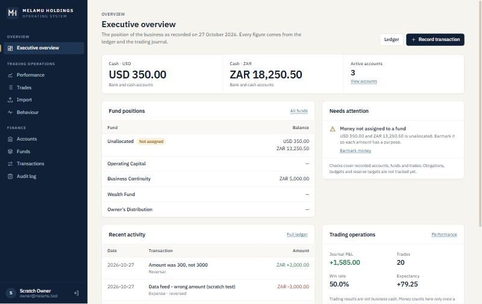

# Design System

The visual identity and interface rules for Melamu Holdings OS.
- **Tokens:** `MelamuHoldings.Angular/src/styles.scss`.
- **Shared components:** `src/app/shared/ui/`.
- **Chart colours:** `CHART` in `shared/ui/chart-theme.ts` mirrors the tokens, because canvas charts cannot read CSS variables.

The audit behind these decisions is in [`UI_AUDIT.md`](UI_AUDIT.md).

## Intent

A calm, institutional workspace for running a business's money:
- hierarchy carried by type, spacing and alignment rather than colour;
- figures that line up;
- tables for comparisons and charts only for trends;
- every element earns its place.

**Avoided:** gradients, glows, glassmorphism, oversized KPI cards, decorative charts, colour used for decoration, and placeholder data.

**Reference products:** Mercury, Ramp and Stripe were studied from screenshots supplied with the brief, for their qualities rather than their layouts. The live sites were not browsed. Nothing is copied: the mark, palette and layouts are Melamu Holdings' own.

## Identity

The owner chose this design on 2026-11-04 (decision D13). It starts from the logo they supplied, [`images/brand-reference.jpg`](images/brand-reference.jpg).

- **Mark:** the supplied M, redrawn as a vector from measurements of the image, with two candlesticks. The owner asked for an H, so the candlesticks are its stems: the gold one moved slightly right, and a gold bar joins them. The silver M is otherwise unchanged. The brushed-metal texture and embossing became a plain silver gradient, because they do not scale down.
- **Lettering:** `MELAMU HOLDINGS` and `(PTY) LTD` in Playfair Display Bold, and `TRADING EXPANSIONS. BUILDING FREEDOM` in Lato Regular, with no closing full stop, as in the supplied image. Both fonts are under the SIL Open Font License. The lettering is converted to outlines, so the logo needs no web font. The application's own text is still IBM Plex Sans until the Phase 10 typography pass.
- **Colours:** on light backgrounds, the silver and champagne sampled from the supplied image. On navy, a lighter silver and a stronger gold (`#D6BF8C`). The small mark on white uses a deeper silver, because the supplied tones are too pale at that size.
- **Files**, in `MelamuHoldings.Angular/public/`:

  | File | Use |
  |---|---|
  | `brand/melamu-logo-full-light.svg`, `-dark.svg` | The full logo with the company designation and tagline, for formal surfaces |
  | `brand/melamu-mark-light.svg`, `-dark.svg` | The compact mark |
  | `brand/melamu-lockup-light.svg`, `-dark.svg` | The mark beside the name on two lines |
  | `favicon.svg`, `brand/icon-32.png`, `icon-180.png`, `icon-512.png` | Browser and application icons: the mark on the navy tile, with candles, wicks and bar thickened so they survive at 16 px |

- **In the application:** `<app-brand-mark>` and `<app-brand-name>` draw the mark and the name inline, from `shared/ui/brand-art.ts`. Each mark has its own gradient, because a gradient defined in a hidden copy would leave a visible one unfilled.
- **Where it appears:** sidebar, phone top bar, sign-in page (the full logo on the navy panel, the mark and name on a phone), favicon, `theme-color`.
- **Known limits:**
  - The H is subtle: some people will first read an M with candlesticks.
  - The original design file does not exist in the repository, so the M is a measured redraw from an 828 px image. Its edges match the image, but fine curves on the serifs were judged by eye.
  - `(PTY) LTD` states a legal form. Check that the company is registered before using the full logo outside this private system.

## Account panels

The Accounts page shows each account as a panel, with a table view one click away and the choice remembered per browser.

- **A card only where one is recorded (D15).** A bank account with an active payment card shows that card, drawn at card proportions, beside its details: chip, contactless mark, masked number, the provider's name, Active, debit or credit, and the network if stated. Savings, investment and other accounts with no card stay plain panels, because not every account is a debit card. A cancelled card is listed, not drawn.
- **Masked, never invented.** The number shows only the recorded last four digits. Expiry and security code are always masked, because they are never stored. No cardholder name is shown. With no digits recorded, the whole number is masked.
- **The owner chooses the style, to resemble the card in hand.** Dark green and gold, black with teal arcs, black with gold lines, yellow or green with foil, navy, graphite, gold, silver, plum or teal. The colours and patterns are general and generated by the app. The artwork of any bank's card is not traced or copied.
- **No bank or network logos.** The provider and network appear as plain text, because no artwork has been licensed. The footnote says the cards are drawn from what was recorded, not the bank's artwork, and that nothing connects to a bank. The owner agreed to reproducing the designs, but the marks belong to the banks, Visa and others, and this repository is public, so only licensed artwork could replace the drawing. Accounts without a card show the provider as a tile of its initials.
- **Type at a glance.** The top rule is navy for a bank, muted gold for a brokerage and grey for cash or other.
- **Ownership at a glance.** Business accounts come first. Personal accounts and those with ownership not stated are separate groups, each saying they are not counted as business cash.

## Colour

| Token | Value | Use |
|---|---|---|
| `--navy-900` (`--primary`, `--sidebar-bg`) | `#102036` | Brand, sidebar, primary buttons, selected tabs and toggles |
| `--navy-800` (`--primary-hover`) | `#1c304d` | Hover on primary; the mark's tile on dark surfaces |
| `--brass-500` | `#c9a35a` | **Only** the mark's bridge, the active-navigation marker, and focus on the sidebar |
| `--surface-canvas` | `#f6f4ef` | Page background (warm off-white) |
| `--surface` | `#ffffff` | Cards, tables, inputs |
| `--surface-sunken` / `--surface-hover` | `#f9f8f5` / `#f4f2ed` | Table headers and detail rows / row hover |
| `--border` / `--border-subtle` | `#dcd7cd` / `#ebe7df` | Controls / dividers and card edges |
| `--text-primary` | `#172131` | Headings, values |
| `--text-secondary` | `#4b5565` | Labels, descriptions |
| `--text-muted` | `#646c79` | Notes and hints (4.8:1 on canvas, 5.4:1 on white) |
| `--link` / `--focus` | `#1d5c8c` / `#2f6aa3` | Links / focus ring |
| `--positive` / `--negative` | `#1d7a4c` / `#b4322a` | Money in and gains / money out and losses |
| `--warning` / `--info` | `#93560a` / `#1d5c8c` | Needs attention / neutral information |
| `--*-bg` | tints of each status | Backgrounds of tags and notices |

**Rules**
- Every text colour passes WCAG AA on `--surface` and `--surface-canvas`.
- Status colour is never the only signal. It always comes with a sign (`+`/`−`), a word ("Warning", "Not assigned") or an icon.
- Values that are neither gains nor losses (win rate, profit factor, average R, drawdown, balances) are set in `--text-primary`.
- There is **no dark theme in this release.** Components use only semantic tokens, so a dark theme is a token-level change.

## Typography

- **IBM Plex Sans** is used everywhere. `font-variant-numeric: tabular-nums` is set on `body`, so all figures align in columns.
- **IBM Plex Mono** (`.mono`) is used only for identifiers and codes: audit action names, CSV column names.

| Role | Size / weight |
|---|---|
| Page title (`h1`) | 24 px / 600 |
| Card and section title (`h2`) | 15 px / 600 |
| Body, table cells | 14 px and 13.5 px / 400 |
| Labels, notes | 12.5 px and 11.5 px |
| Section label above a title | 11.5 px / 600, uppercase, +0.08em |
| Metric values | 22 px / 600; lead metric 30 px |

## Space, layout and shape

- **Spacing:** a 4 px scale (`--space-1` … `--space-10`). Cards pad 20 px; table cells pad 11 × 16 px.
- **Content width:** pages are centred at a maximum of 1240 px (`--content-max`); Import uses 900 px.
- **Sidebar:** 248 px, fixed, navy. Below 900 px it becomes a white top bar with a drawer.
- **Radii:** 4, 6 and 10 px. Shadows are a single 1 px hairline (`--shadow-sm`) on surfaces, with `--shadow-lg` only for the drawer.

## Components

| Component | Where | Use |
|---|---|---|
| `<app-brand-mark>` | `shared/ui/brand-mark.component.ts` | The mark. Inputs: `size`, `tone` |
| `<app-brand-name>` | `shared/ui/brand-mark.component.ts` | The company name as drawn lettering, in the surrounding colour. Inputs: `layout` (`line`, `stacked`), `height` |
| `<app-icon>` | `shared/ui/icon.component.ts` | The product's own stroke icon set (24-unit grid, 1.6 stroke, round ends). Decorative (`aria-hidden`); the surrounding control carries the label |
| `<app-page-header>` | `shared/ui/page-header.component.ts` | Every page: `section` label, `title`, `description`, with action buttons projected to the right |
| `<app-load-error>` | `shared/load-error.component.ts` | An error state with Retry |
| `.metric-strip` / `.metric` | `styles.scss` | Summary figures on one surface. `.metric-lead` makes the headline figure larger and gives it a full row on phones. Cells are flex items, so a short row stretches instead of leaving a gap |
| `.card`, `.card-header`, `.table-card` | `styles.scss` | Surfaces. A table card has no padding; the table owns its edges |
| `.data-table` | `styles.scss` | Sunken header row, hairline rows, hover. `.num` right-aligns figures. The first link in a row is set as the row's title |
| `.toolbar` | `styles.scss` | Filters inside the top of a table card |
| `.tabs` / `.tab` | `styles.scss` | Switching one view (`role="tablist"`, `aria-selected`) |
| `.btn`, `.btn-primary`, `.btn-danger`, `.btn-sm`, `.btn-link` | `styles.scss` | One primary action per area |
| `.field`, `.form-grid`, `.form-actions` | `styles.scss` | Every input has a visible `<label for>` |
| `.tag-positive/negative/warning/info` | `styles.scss` | Status pills |
| `.notice-error/success/warning` | `styles.scss` | Inline messages |
| `.loading-state`, `.empty-state` | `styles.scss` | Loading, and empty with the next action |
| `.bar-track` / `.bar-fill` | `styles.scss` | Proportional bars in table cells. They diverge from a centre line when values can be negative |
| `baseChartOptions()` | `shared/ui/chart-theme.ts` | Chart.js defaults: no legend for a single series, emphasised zero line, at most 8 unrotated date ticks, navy tooltip |

## Usage conventions

- **Money:**
  - `{{ amount | money: currency }}` renders `ZAR 1,350.00`; `: true` adds `+` to credits.
  - Currencies are shown side by side and are never added together.
  - Trading P&L has no currency yet and is labelled as such: "Figures are in the trading account's currency, which the journal does not record yet". It is never presented as business cash.
- **Signed figures** use a true minus sign (`−`) and a `+` for gains.
- **Status vocabulary:** one treatment per meaning, defined once in `finance.models.ts` (`PAYOUT_STATUS`, `ALLOCATION_STATUS`) and reused everywhere.

  | Meaning | Tag | Used for |
  |---|---|---|
  | Not yet money / not yet acted on | neutral `tag` | Payout *Requested*, allocation *Cancelled*, policy *Not in use*, purchase *Proposed* and *Cancelled*, prop account *Closed* |
  | Committed, nothing moved yet | `tag-info` | Payout *Approved*, allocation *Confirmed*, purchase *Committed* |
  | Part done, needs attention | `tag-warning` | Allocation *Partially settled*, obligation *Due soon*, prop account *Pending*, *Not assigned* (Unallocated money), fee entries |
  | Done and reconciled | `tag-positive` | Payout *Received*, allocation *Reconciled*, line *Settled*, policy *Active*, obligation *Paid*, purchase *Purchased*, prop account *Active* |
  | Refused or overdue | `tag-negative` | Payout *Rejected*, obligation *Overdue*, *Expense reversed*, prop account *Breached* |

  Expected amounts (requested or approved payouts) always carry the words "not cash".
- **Progress pages** (a payout) show the steps as a vertical timeline beside a single "Next step" panel that offers only the actions the current status allows.
- **Navigation lists only working destinations.** The roadmap lives in `PLAN.md`, not in the sidebar.
- **Irreversible actions ask first.** Deleting a trade and closing an account each need a second click; a reversal needs a written reason. Native `confirm()` is not used.
- **Every data view has three states:** loading, empty (with the next action) and error (with Retry). Independent panels load and fail independently: the overview still shows trading results if the finance data is refused.
- **Charts:** a chart only for a trend over time. Straight segments with no smoothing, and labels set as "8 Oct" rather than ISO dates.
- **Accessibility:**
  - one `h1` per page;
  - visible labels on every input;
  - `aria-current="page"` on the active link;
  - a visible focus ring on every focusable element (blue on light surfaces, brass on the sidebar);
  - icon-only buttons carry screen-reader text;
  - motion off under `prefers-reduced-motion`.
- **Responsive:**
  - no horizontal page scroll at 375 px;
  - wide tables scroll inside their card;
  - the breakdown bar column hides on phones.
- **Component styles stay under the 4 kB budget.** Anything shared goes in `styles.scss`.
