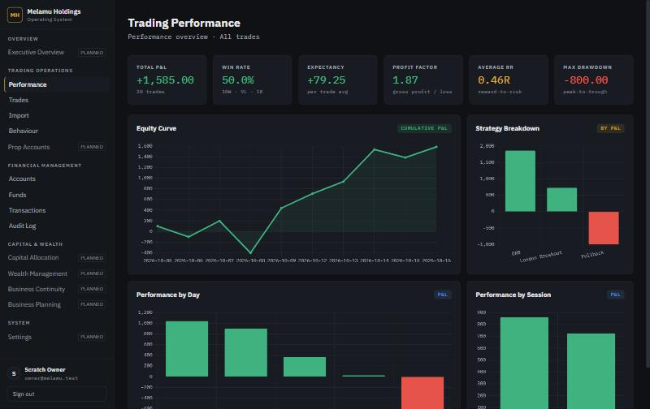

# UI Audit — before the Melamu Holdings brand redesign

Audited on 2026-10-27 against branch `phase-4-ledger`, in a browser at 1366 × 860 against the scratch database, together with a read of every Angular component.

**About the reference products:** the reference material was the 29 screenshots of Mercury, Ramp, Stripe and other financial products supplied with the brief. The live websites were not browsed for this audit.

## 1. Current visual structure

**Shell** (`core/layout/shell.component.ts`)
- A fixed 240 px dark sidebar holds the brand, five navigation groups and the user footer. Below 900 px it becomes a top bar with a drawer.
- Navigation comes from a data file (`navigation.ts`): 9 live links and 7 "Planned" items.

**Theme** (`styles.scss`)
- Dark only: near-black `#0f1115` surfaces, a gold accent and green/red status colours.
- Fonts: IBM Plex Sans, plus IBM Plex Mono for figures.

**Pages**
- **Performance:** six equal KPI cards, then four chart cards (equity curve, strategy, day, session).
- **Trades:** a filter bar and a 13-column table.
- **Import:** a drop zone, a CSV column list and upload history.
- **Behaviour:** six metric cards, an insight panel and an alert feed.
- **Finance (Accounts, Funds, Transactions, Audit log, Record transaction):** built in Phase 4 on shared classes (`.page`, `.data-table`, `.btn`, `.field`, `.notice`).
- **Login:** a centred card.

**Shared pieces**
- `LoadErrorComponent`, the `money` pipe and `describeHttpError`.
- The `.loading-state` spinner markup, copied into each page.

## 2. Major usability issues

| # | Issue | Where |
|---|---|---|
| U1 | **The landing page is a trading chart, not the business.** Signing in lands on Trading Performance. Nothing shows the business's cash, funds or what needs attention. | Routes |
| U2 | **Every KPI is equally loud.** Six identical cards all carry status colour. Average RR is gold for no reason. Win rate turns green at exactly 50%, an arbitrary threshold. Max drawdown is always red. Colour stops meaning anything. | Performance, Behaviour |
| U3 | **The charts are hard to read.** The equity curve crowds full ISO dates (`2026-10-08`) onto the axis. Strategy labels are rotated inside a one-third-width card. The day and session charts are bar charts of four or five values that a table would show precisely. Each chart carries a redundant chip ("CUMULATIVE P&L", "BY P&L", "P&L"). | Performance |
| U4 | **Monospace everywhere.** Subtitles, sub-labels, inputs, empty states and axis ticks are all set in Plex Mono, so the product reads like a terminal. | All trading pages, Login |
| U5 | **Trading P&L has no currency and no caveat.** "+1,585.00" sits on its own, and nothing says that trading profit is not business cash until a payout arrives. | Performance |
| U6 | **The trading pages and finance pages look like two products.** The trading pages each declare their own header, table, input and button styles (`.page-header` with an 800-weight h1, local `table`/`th`/`td`, `.filter-input`, `.btn-clear`, `.btn-retry`). The finance pages use the shared classes. | Trading pages |
| U7 | **Glyphs stand in for icons.** `✕` for delete, `⊕`/`⟳` on the drop zone, `⚠` on the insight card and `✓` in empty states. They render differently on each operating system, and there is no icon set. | Trades, Import, Behaviour |
| U8 | **Native `confirm()` for deleting a trade.** It is inconsistent with the inline two-step confirmation used for closing an account. | Trades |

## 3. Branding gaps

- **The logo is the text "MH" in a gold-outlined box,** both in the app and in `favicon.svg`. That is an abbreviation, not a mark. The favicon also depends on a font the browser may not have.
- **There is no wordmark treatment.** "Melamu Holdings / Operating System" is set in ordinary body type.
- **The sidebar advertises the roadmap.** Seven permanent "PLANNED" badges make the product read as a prototype. The Overview group contains only a planned item.
- **Near-black plus gold is the look of a generic trading terminal,** the impression the brief asks to leave behind. The finance references (Mercury, Ramp, Stripe) are light, calm and table-led.
- **Login** shows the same text mark and says nothing about the business.

## 4. Worth preserving

- **The shell's structure:** data-driven navigation, `aria-current` on the active link, the drawer with Escape and backdrop, closing on navigation, and the reduced-motion rule.
- **The finance pages' shared classes** (`.page`, `.data-table`, `.btn*`, `.form-grid`/`.field`, `.notice*`, `.amount-in/out`). They become the base of the design system.
- **Behaviour:**
  - the `money` pipe, which always shows a currency code;
  - `LoadErrorComponent` with Retry;
  - `describeHttpError`, including the 403 "sign in again" message.
- **Every page's three states** (loading, empty, error), their signals-based zoneless data loading, and every API contract. The redesign changes none of these.
- **The equity curve as a chart** (a trend over time is what a chart is for), with straight segments and no smoothing.

## 5. Components that need redesign

| Component | Change |
|---|---|
| Brand mark and favicon | Replace with a vector MH monogram, plus a typeset wordmark lock-up |
| Shell | Navy brand sidebar with icons, only the live destinations, refined active state, account footer, consistent page width |
| Page headers | One `app-page-header`: section label, title, description and action slot. It replaces both the trading and finance header styles |
| KPI cards | A **metric strip**: one surface with the headline figure first and grouped secondary figures. Colour only where the sign carries meaning |
| Day, session and strategy charts | One **breakdown table** with tabs, exact figures and an inline proportional bar |
| Trading tables and filters | Move to the shared `.data-table`, `.toolbar` and `.field` classes |
| Glyph icons | `app-icon`, one stroke icon set drawn for this product |
| Trade deletion | An inline "Delete / Confirm delete" pair, the same pattern as closing an account |
| Login | A brand panel and form with the new identity |
| Loading and empty states | Shared `.empty-state` styles alongside `.loading-state` |

## 6. Accessibility and responsiveness

**Already in place**
- Focus rings on every focusable element.
- Labelled inputs on the finance pages.
- `aria-current` on the active link.
- The drawer exposes `aria-expanded`.
- No horizontal page scroll at 375 px (checked in Phase 3 and Phase 4).

**Issues**
- The Trades filter inputs rely on `aria-label` and placeholder text, with no visible labels.
- Status is shown by colour alone in several places:
  - the left border on winning and losing trade rows;
  - KPI value colours;
  - the alert severity border. That one is paired with a text tag, which is acceptable.
- The delete button is a bare `✕`. It has an aria-label, but the visual affordance is poor.
- Axis ticks at 10 px monospace are below a comfortable reading size.

## 7. Design direction

The direction is a calm, light, table-led workspace anchored by a deep navy brand sidebar. Its qualities come from the references: hierarchy through type and spacing rather than colour, figures set to line up, and few surfaces. The look is Melamu Holdings' own.

- **Palette:**
  - warm off-white canvas, white surfaces, warm grey borders;
  - deep navy for the brand, primary actions and headings;
  - one muted brass accent, reserved for the mark and the active-location marker;
  - status colours used only for meaning, always paired with a sign, word or icon.
- **Type:**
  - IBM Plex Sans throughout, with tabular figures for numbers;
  - IBM Plex Mono only for identifiers and codes;
  - a tracked-capitals wordmark.
- **Layout:**
  - one content width;
  - one page-header pattern;
  - a metric strip for summaries;
  - charts only for trends;
  - tables for comparisons.
- **The Executive Overview becomes the landing page.** It is built only from data the API already provides:
  - cash position by currency;
  - fund positions;
  - what needs attention, derived from real records;
  - recent ledger activity;
  - a trading summary, explicitly labelled as not business cash.
- **No dark theme in this pass.** The tokens are structured so one can be added later without touching components.

## 8. Implementation plan

1. Brand mark component and favicon; design tokens rewritten in `styles.scss`.
2. Shell and navigation, showing live destinations only.
3. Executive Overview at `/overview`, which becomes the landing route.
4. Trading Performance: metric strip, readable equity curve, breakdown table.
5. Trades, Import, Behaviour and Login migrated to the shared components. The finance pages pick up the tokens automatically.
6. Verification: build, unit tests (updated for the new navigation and pages), and a browser walkthrough at desktop and phone widths.
7. `docs/DESIGN_SYSTEM.md` replaces `docs/DESIGN.md`.

Out of scope: any API, calculation or domain change. One defect found during the audit is recorded rather than fixed: profit factor with no losses (already scheduled for Phase 8).
